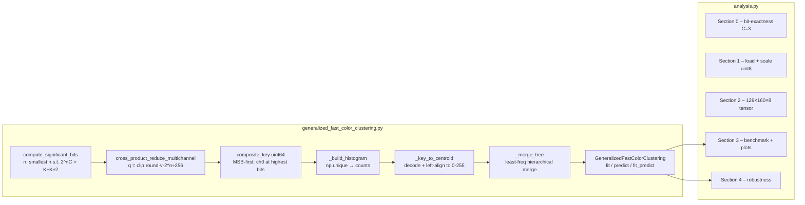
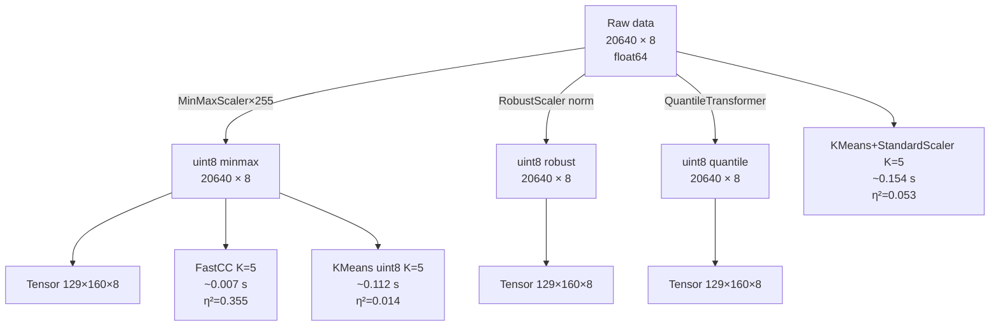

# Architecture

## Overview

This project generalises IBM Patent US 11,763,422 B2 (Fast Color Clustering) from 3-channel (RGB) images to C-channel tabular data. The key insight is treating each tabular row as a "pixel" and each scaled feature as a "colour channel".

## Module Map



## Algorithm Detail

### Step 1 — Bit Depth (patent claim 1)

```
n = min{n ∈ 1..8 : 2^(n·C) > K + max(1, K÷2)}
```

For K=5, C=8: n=1 (2^8 = 256 > 7). For K=5, C=3: n=1 (2^3 = 8 > 7).

### Step 2 — Cross-Product Quantisation

```
q_c = clip(round(v_c · 2^n / 256), 0, 2^n − 1)
```

Matches the reference code formula exactly. This is equivalent to the patent's
`round((2^n−1)·v/255)` for most values and ensures bit-exact agreement.

### Step 3 — Composite Key (uint64, MSB-first)

```
key = (q_0 << (C-1)·n) | (q_1 << (C-2)·n) | … | q_{C-1}
```

For C=3 this reduces to `(q0 << 2n) | (q1 << n) | q2`, identical to the reference `color_index()`.

### Step 4 — Histogram

`np.unique(keys, return_counts=True)` gives the L distinct keys and their pixel counts. L ≤ 2^(n·C).

### Step 5 — Hierarchical Merge Tree (patent FIG. 3)

```
while n_active > K:
    i = argmin(counts[alive])                       # least-frequent
    j = argmin(‖centroid_i − centroid_j‖²)          # nearest neighbour
    merge(i, j): new_centroid = (c_i·n_i + c_j·n_j)/(n_i+n_j)
                 new_count    = n_i + n_j
```

Centroids are maintained in left-aligned [0,255] space for metric consistency.

### Step 6 — Final Centroids

After label assignment, final centroids are computed as the mean of original uint8 rows in each cluster (`model.centroids_orig_`).

### Step 7 — LUT

A Python dict maps every seen composite key to a cluster label. Unseen keys (at predict time) are assigned to the nearest palette centroid.

## Bit-Exactness Proof (C=3)

| Property | Reference (C=3) | Generalised (any C) |
|---|---|---|
| Quantisation formula | `round(v·2^n/256)` | same |
| Key encoding | `(q0<<2n)\|(q1<<n)\|q2` | `(q0<<(C-1)n)\|…` = same for C=3 |
| Centroid initialisation | left-aligned `q<<(8-n)` | same via `_key_to_centroid(left_align=True)` |
| Merge distance metric | Euclidean on left-aligned | same |
| Tie-breaking | `np.argmin` (first min) | same |
| **ARI on astronaut image** | **—** | **1.000000** ✓ |

## Data Flow — California Housing




