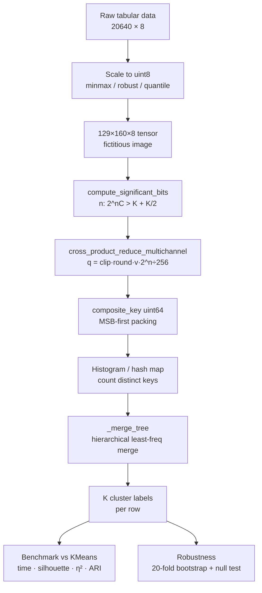
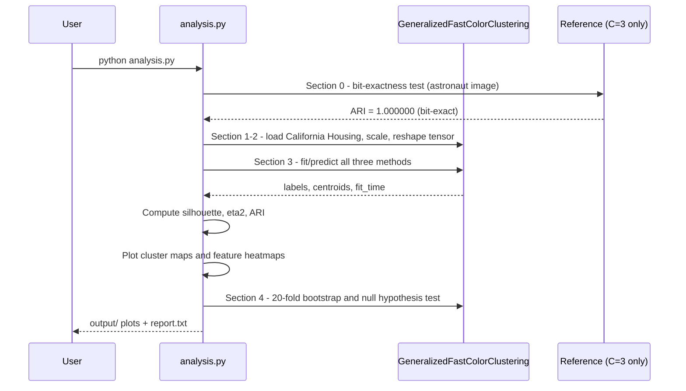

# Generalized Fast Color Clustering for Tabular Data

Extends IBM Patent **US 11,763,422 B2** (*Fast Color Clustering for Preprocessing an Image*) from 3-channel RGB images to arbitrary C-channel feature spaces, demonstrated on the California Housing dataset.

## Architecture



## Workflow



## Key Results (K=5, minmax scaling)

| Method | Time (s) | Silhouette | η² (price) | ARI vs Std |
|---|---|---|---|---|
| KMeans + StandardScaler | 0.154 | 0.295 | 0.053 | 1.000 |
| KMeans + uint8 | 0.112 | 0.323 | 0.014 | 0.423 |
| **Generalized FastCC** | **0.007** | 0.131 | **0.355** | 0.356 |

- **FastCC is ~22× faster** than KMeans and captures strong house-price structure (η² = 0.355).
- Bootstrap stability: ARI = 0.862 ± 0.090 across 20 folds.
- Null hypothesis: silhouette degrades 0.036 on shuffled data (p < 0.0001), confirming real signal.

## Project Structure

```
.
├── generalized_fast_color_clustering.py  # Generalized C-channel algorithm
├── analysis.py                           # Full analysis pipeline
├── requirements.txt
├── _sources/                             # Reference implementation (C=3)
│   ├── fast_color_clustering.py
│   └── US11763422.pdf
├── output/                               # Timestamped plots + report
└── Docs/
    ├── Quickstart.md
    └── Architecture.md
```

## Setup

```bash
uv venv .venv && source .venv/bin/activate
uv pip install -r requirements.txt
python analysis.py
```

## License

MIT License — research adaptation of IBM Patent US 11,763,422 B2 for academic / educational use.
